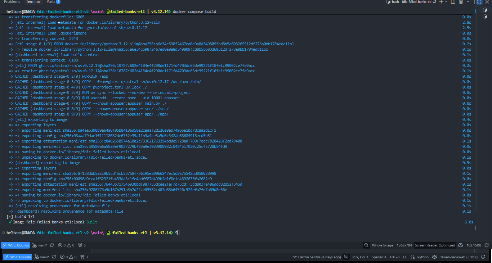
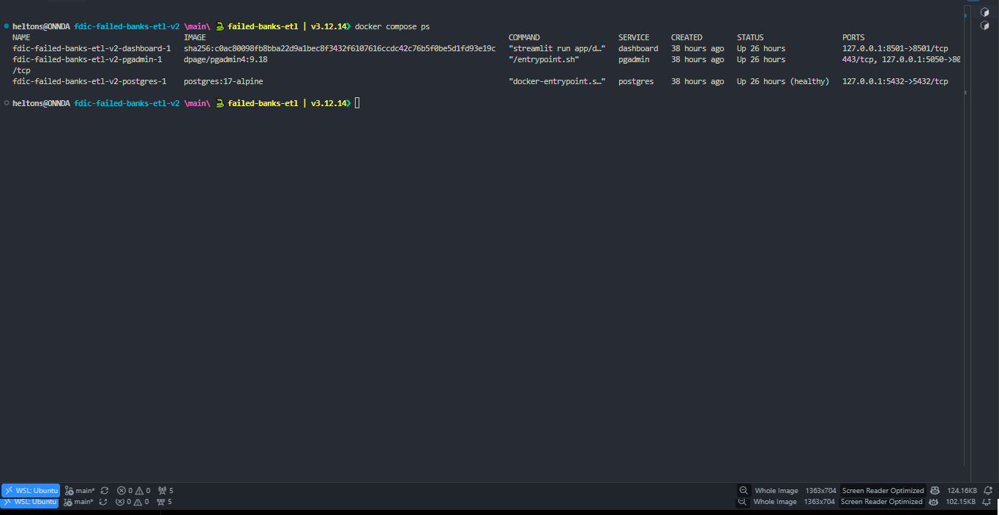
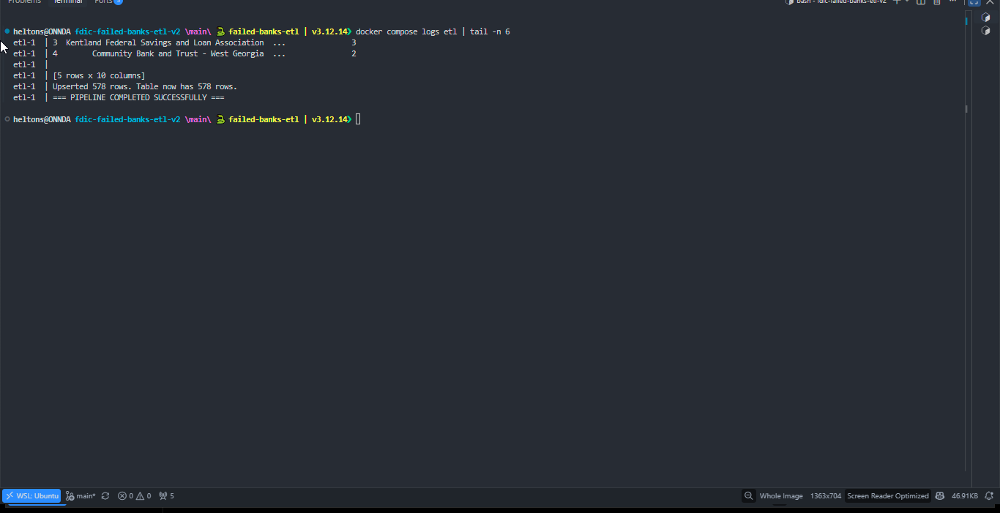
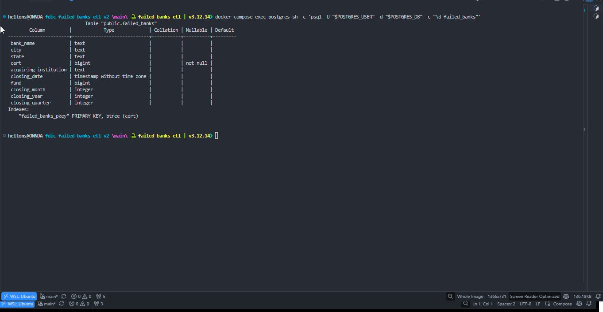
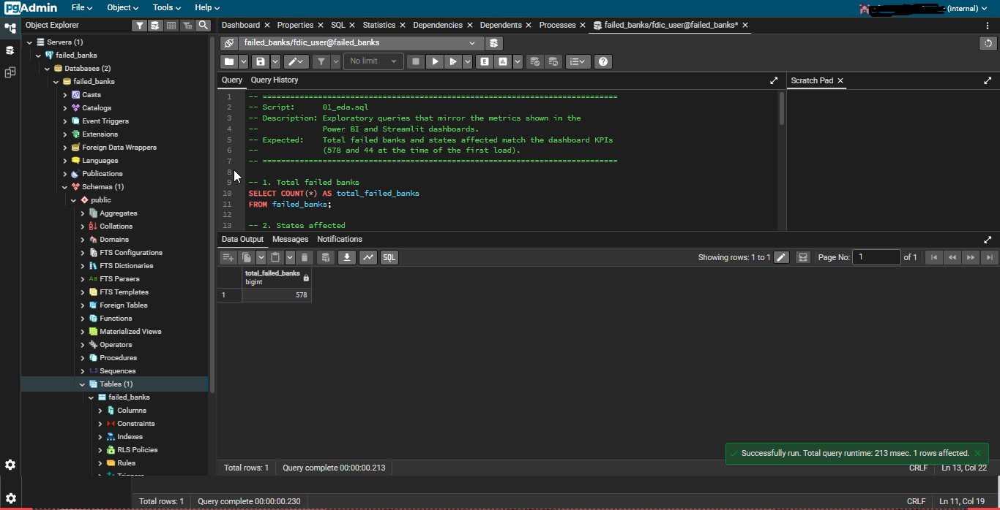
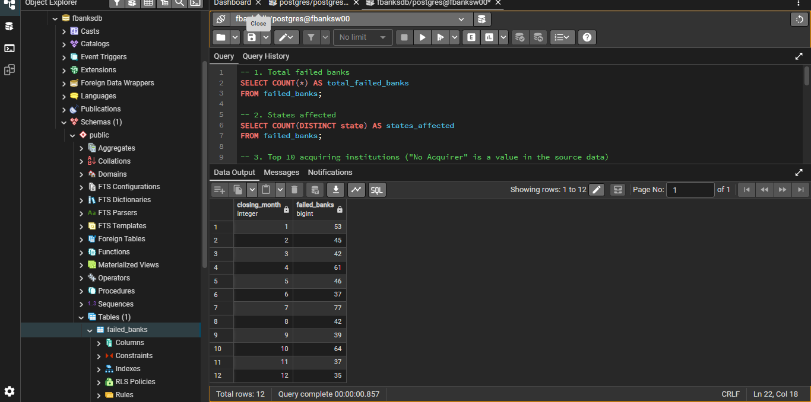

# 🏦 FDIC Failed Banks — Dockerized ETL Pipeline

End-to-end Data Engineering project that extracts U.S. bank failure records from the FDIC, transforms and validates the data with Python, loads it into PostgreSQL, and delivers insights through SQL analysis and an interactive Streamlit dashboard.

This version extends the original project with **Docker, Docker Compose, PostgreSQL persistence, automated ETL execution, and a reproducible local development environment**.


---

## 📌 Overview

The Federal Deposit Insurance Corporation (FDIC) publishes records of U.S. bank failures. This project transforms the public CSV dataset into a clean, queryable database and provides an analytical environment for exploring historical bank failures.

The project addresses business questions such as:

- How many banks failed, and how many states were affected?
- When did bank failures peak?
- Which states recorded the highest number of failures?
- Which institutions acquired the most failed banks?
- How can data quality be validated before and after loading?

**Dataset at a glance (initial validated run):** 578 bank failure records · 44 states · 2000–2026.

The Dockerized version packages the ETL application and supporting services into a consistent environment, reducing manual setup and making the project easier to reproduce.

---

## 🧰 Tech Stack

| Layer | Tools |
|---|---|
| Language | Python 3.12 |
| Data processing | pandas |
| Data extraction | requests |
| Database | PostgreSQL 17 |
| Database connectivity | SQLAlchemy, psycopg2 |
| Analysis | SQL |
| Interactive dashboard | Streamlit, Plotly |
| Database administration | pgAdmin |
| Containerization | Docker, Docker Compose |
| Dependency management | uv |
| Configuration | Environment variables, python-dotenv |

---

## 🏗️ Architecture

```text
           FDIC PUBLIC CSV
                  |
                  v
          PYTHON ETL PIPELINE
        +---------------------+
        | Extract              |
        | Transform & Validate |
        | Load / Upsert        |
        +---------------------+
                  |
                  v
             POSTGRESQL
           failed_banks
                  |
          +-------+-------+
          |       |       |
          v       v       v
         SQL   Streamlit pgAdmin

      Docker Compose orchestrates
      the application and services.
```

### ETL Pipeline

| Step | Module | Responsibility |
|---|---|---|
| Extract | `src/extract.py` | Retrieves the FDIC CSV using HTTP retries and connection/read timeouts. |
| Transform | `src/transformations.py` | Normalizes column names and whitespace, parses closing dates, and derives month, year, and quarter. |
| Load | `src/load.py` | Validates the input and loads records into PostgreSQL using an upsert strategy. |
| Connection | `src/db.py` | Creates the SQLAlchemy engine using environment-based configuration. |
| Orchestration | `main.py` | Executes extraction, transformation, and loading in sequence. |

### Docker Services

| Service | Responsibility |
|---|---|
| `postgres` | Stores the processed dataset in PostgreSQL. |
| `etl` | Runs the Python pipeline after PostgreSQL becomes healthy. |
| `dashboard` | Runs the Streamlit dashboard after successful ETL completion. |
| `pgadmin` | Provides a browser-based interface for database administration and SQL queries. |

Docker Compose coordinates service startup, health checks, dependencies, networking, and persistent volumes.





---

## 📂 Project Structure

```text
fdic-failed-banks-etl-v2/
├── app/
│   └── dashboard.py
├── images/
│   ├── demo-01-streamlit.gif
│   ├── demo-02-sql-query-connection.gif
│   ├── docker-01-build.png
│   ├── docker-02-service.png
│   ├── docker-03-etl-log.png
│   ├── docker-04-schema.png
│   └── docker-05-pgadmin-*.png
├── sql/
│   ├── 01_eda.sql
│   ├── 02_data_quality.sql
│   ├── 03_business_analysis.sql
│   └── 04_rankings.sql
├── src/
│   ├── __init__.py
│   ├── db.py
│   ├── extract.py
│   ├── load.py
│   └── transformations.py
├── .dockerignore
├── .env.example
├── .gitignore
├── Dockerfile
├── docker-compose.yml
├── main.py
├── pyproject.toml
└── uv.lock
```

---

## 🚀 Getting Started

### Prerequisites

- [Git](https://git-scm.com/)
- [Docker Desktop](https://www.docker.com/products/docker-desktop/) with Docker Compose, or Docker Engine and the Compose plugin on Linux
- [WSL 2 with Ubuntu](https://learn.microsoft.com/en-us/windows/wsl/install) if developing on Windows

The Docker workflow does not require a separate local Python installation or a locally installed PostgreSQL server.

### 1. Clone the repository

```bash
git clone https://github.com/heltonwo/fdic-failed-banks-etl-v2.git
cd fdic-failed-banks-etl-v2
```

### 2. Configure environment variables

Create a local environment file from the example:

```bash
cp .env.example .env
```

Open `.env` and replace the example passwords with strong, unique values.

```dotenv
# PostgreSQL credentials
DB_USER=fdic_user
DB_PASSWORD=replace_with_a_strong_password
DB_NAME=failed_banks

# Internal Docker network
DB_HOST=postgres
DB_PORT=5432

# Host port for local database access
DB_PUBLISHED_PORT=5432

# pgAdmin credentials
PGADMIN_DEFAULT_EMAIL=admin@example.com
PGADMIN_DEFAULT_PASSWORD=replace_with_another_strong_password
PGADMIN_PUBLISHED_PORT=5050
```

The `.env` file is excluded from version control and the Docker build context. **Never commit real credentials.**

`DB_HOST=postgres` is the database hostname used by services inside the Docker Compose network.

### 3. Build and start the environment

```bash
docker compose up --build -d
```

Docker Compose starts PostgreSQL, waits for its health check, executes the ETL pipeline, and starts the dashboard after successful ETL completion.

Check the service status:

```bash
docker compose ps
```

Inspect the ETL execution:

```bash
docker compose logs -f etl
```

The initial validated execution loaded 578 records into PostgreSQL.



---

## 🗄️ Database and Persistence

The processed dataset is stored in the `failed_banks` table.

The loading process uses PostgreSQL `ON CONFLICT DO UPDATE`, with `cert` as the conflict key. New certificate identifiers are inserted, while existing records are updated. This avoids intentionally truncating the entire table on every run.

### Verify the loaded data

Connect to PostgreSQL through pgAdmin and execute:

```sql
SELECT
    COUNT(*) AS total_records,
    COUNT(DISTINCT cert) AS unique_certificates,
    COUNT(*) FILTER (
        WHERE cert IS NULL
    ) AS null_certificates,
    MIN(closing_date) AS first_closing_date,
    MAX(closing_date) AS last_closing_date
FROM failed_banks;
```

The initial validated run returned 578 records, 578 unique certificate identifiers, and zero null certificate identifiers. Results may change as the source dataset is updated.



### Data persistence

PostgreSQL and pgAdmin use named Docker volumes.

```bash
# Stop the environment while preserving volumes
docker compose down

# Start the services again
docker compose up -d
```

**Important:** `docker compose down -v` removes the named volumes and deletes their persisted database and pgAdmin data. Use it only when you deliberately want to reset the environment.

---

## 🐳 Accessing the Services

| Service | URL | Purpose |
|---|---|---|
| Streamlit | [http://localhost:8501](http://localhost:8501) | Explore the dataset interactively. |
| pgAdmin | [http://localhost:5050](http://localhost:5050) | Manage PostgreSQL and run SQL queries. |
| PostgreSQL | `localhost:5432` | Connect from a database client on the host. |

### Connect pgAdmin to PostgreSQL

1. Open [http://localhost:5050](http://localhost:5050).
2. Sign in using the pgAdmin credentials configured in `.env`.
3. Register a new server.
4. Under **General**, enter a name such as `FDIC PostgreSQL`.
5. Under **Connection**, configure the following values:

| Setting | Value |
|---|---|
| Host name/address | `postgres` |
| Port | `5432` |
| Maintenance database | Value of `DB_NAME` |
| Username | Value of `DB_USER` |
| Password | Value of `DB_PASSWORD` |

Use `postgres` as the hostname because pgAdmin communicates with PostgreSQL through the internal Docker network.





---

## 🗄️ SQL Analysis

The `sql/` folder contains four scripts for exploratory analysis, data quality validation, business analysis, and rankings.

| Script | Purpose |
|---|---|
| `01_eda.sql` | Exploratory data analysis and dataset profiling. |
| `02_data_quality.sql` | Row counts, null checks, duplicate checks, and date validation. |
| `03_business_analysis.sql` | Analysis of bank failures by year, state, acquiring institution, and month. |
| `04_rankings.sql` | Ranking analysis, including years and states with the highest failure counts. |

The scripts can be executed in pgAdmin's Query Tool after connecting to the database.


---

## 📊 Streamlit Dashboard

The interactive dashboard reads the processed dataset from PostgreSQL and provides a visual interface for exploring bank failures.

Features include:

- Key performance indicators summarizing bank failures.
- A year-range slider to filter the dashboard.
- Cross-filtering between states and acquiring institutions.
- Annual failure trends.
- Monthly seasonality analysis.
- Interactive Plotly visualizations.


---

## ✅ Data Quality

Data validation is performed throughout the pipeline and supported by SQL checks.

The project covers:

- Expected columns and dataset structure.
- Empty input and invalid or duplicate certificate identifiers.
- Null checks across database columns.
- Duplicate detection using certificate identifiers and composite keys.
- Closing-date range and invalid date checks.
- Record counts and uniqueness after loading.

The SQL validation scripts are located in `sql/`, while structural and loading validations are implemented in the Python pipeline.

---

## 🔎 Key Findings

The initial validated dataset contained 578 failed-bank records across 44 states, covering 2000–2026.

The exploratory analysis identified:

- A concentration of failures around the 2008–2010 financial crisis.
- Georgia, Florida, and Illinois among the states with the highest recorded failure counts in the analyzed snapshot.
- Variation in bank failures by closing month.
- Records for which no acquiring institution was listed.

These observations describe the analyzed dataset snapshot, not permanent values. Results depend on the source data and query definitions.

---

## 🛠️ Troubleshooting

### PostgreSQL is not healthy

Inspect the database logs and service status:

```bash
docker compose logs postgres
docker compose ps
```

Check that `.env` contains valid configuration and that the database can initialize successfully.

### The dashboard does not start

Inspect the ETL and dashboard logs:

```bash
docker compose logs etl
docker compose logs dashboard
```

The dashboard depends on successful ETL completion. Resolve any underlying database or ETL errors before restarting it.

### A host port is already in use

The default host ports are `5432`, `5050`, and `8501`.

- `DB_PUBLISHED_PORT` controls the published PostgreSQL port.
- `PGADMIN_PUBLISHED_PORT` controls the published pgAdmin port.
- The Streamlit published port is configured in `docker-compose.yml`.

If you change a published port, update the corresponding connection details or URL. The internal PostgreSQL port remains `5432`.

### Database credentials no longer match `.env`

Changing `.env` does not automatically update credentials in an already initialized PostgreSQL volume. Change the database credentials deliberately, or reset a disposable development environment only after understanding that deleting the database volume permanently removes its persisted data.

---

## 🗺️ Roadmap

Potential improvements include:

- Add automated unit and integration tests with `pytest`.
- Introduce structured logging and more consistent error reporting.
- Add CI checks for formatting, linting, and automated tests.
- Improve pipeline observability and execution metrics.
- Add automated data freshness and schema-change checks.
- Deploy the dashboard and pipeline to a cloud environment.

These are proposed improvements, not features claimed as completed.

---

## 👤 Author

**Helton Santos**

- GitHub: [@heltonwo](https://github.com/heltonwo)
- LinkedIn: [Helton Santos](https://www.linkedin.com/in/helton-santos-754a69206)

---

## 📄 Data Source

Bank failure records are publicly available from the official [Federal Deposit Insurance Corporation (FDIC)](https://www.fdic.gov/resources/resolutions/bank-failures/failed-bank-list/).

---

This project is part of my Data Engineering portfolio, demonstrating Python ETL development, SQL analysis, PostgreSQL data loading, data quality validation, Docker containerization, service orchestration, and reproducible local development.